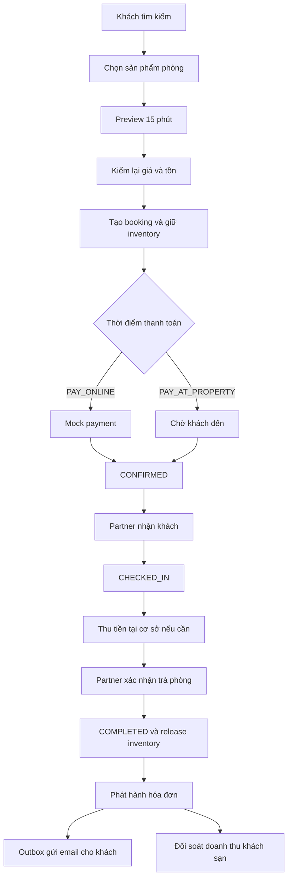
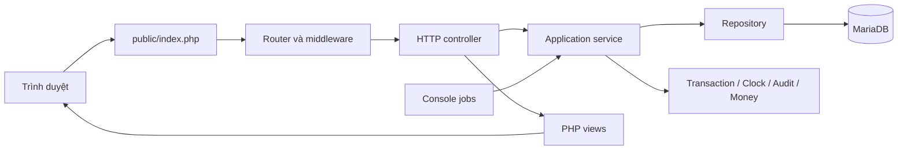

# StayBooking — hệ thống tìm kiếm và đặt chỗ lưu trú

StayBooking là một **Mini OTA** (*online travel agency*) dành cho thị trường lưu trú
tại Thành phố Hồ Chí Minh. Khách hàng có thể tìm chỗ nghỉ, so sánh sản phẩm phòng,
đặt nhiều phòng và theo dõi booking. Đối tác khách sạn quản lý cơ sở, giá, tồn phòng
và toàn bộ quá trình phục vụ khách. Quản trị viên kiểm duyệt dữ liệu và theo dõi hoạt
động chung của hệ thống.

Dự án dùng PHP 8.2+, MariaDB/MySQL và kiến trúc **Modular Monolith**. Backend và
frontend không phụ thuộc framework; routing, middleware, dependency container,
transaction và view rendering được xây dựng trực tiếp trong mã nguồn.

README đi theo thứ tự mà một người mới cần để hiểu dự án: hệ thống giải quyết bài
toán gì, có những vai trò và chức năng nào, một booking đi qua hệ thống ra sao, mã
nguồn được chia thế nào, sau đó mới đến cách cài đặt, chạy và kiểm thử.

## 1. Hệ thống giải quyết bài toán gì?

Một quy trình đặt chỗ không kết thúc khi khách bấm “Đặt phòng”. Hệ thống còn phải giữ
đúng tồn phòng, ghi lại giá và chính sách tại thời điểm đặt, xử lý thanh toán, thay đổi
ngày, hủy phòng, nhận khách, trả phòng, hóa đơn và doanh thu của khách sạn.

StayBooking tập trung vào ba yêu cầu:

1. **Khách đặt đúng sản phẩm đang còn chỗ:** counter tồn và ledger giữ phòng phải
   luôn khớp nhau, kể cả khi có hai yêu cầu đồng thời.
2. **Dữ liệu lịch sử không bị thay đổi theo catalog hiện tại:** giá, khách, điều kiện
   và hóa đơn được lưu dưới dạng snapshot.
3. **Mỗi vai trò chỉ thao tác đúng phạm vi:** customer chỉ đọc booking của mình;
   partner chỉ quản lý dữ liệu thuộc tổ chức; admin có các quyền vận hành riêng.

Đây là dự án học tập có dữ liệu fixture tổng hợp. Nó không phải hệ thống đang vận
hành với dữ liệu thật và không nên dùng các tài khoản fixture trong production.

## 2. Những khái niệm cần biết

| Tên gọi | Nghĩa trong dự án |
|---|---|
| **OTA** | nền tảng trung gian để khách tìm và đặt chỗ lưu trú |
| **Property / cơ sở** | một khách sạn hoặc cơ sở lưu trú thuộc tổ chức đối tác |
| **Room type / loại phòng** | loại phòng vật lý được quản lý tồn theo từng ngày |
| **Room product / sản phẩm phòng** | cách bán một loại phòng, kết hợp bữa ăn, chính sách hủy và thời điểm thanh toán |
| **Preview** | báo giá tạm thời trong 15 phút; chưa giữ tồn phòng |
| **Booking** | đặt chỗ đã được tạo từ preview; lúc này hệ thống mới giữ tồn |
| **Snapshot** | bản chụp dữ liệu lịch sử tại thời điểm xảy ra nghiệp vụ |
| **Ledger giữ phòng** | từng dòng giữ một phòng cho một đêm; dùng để đối chiếu counter tồn |
| **Tenant scope** | giới hạn dữ liệu theo tổ chức đối tác đang đăng nhập |
| **Transactional outbox** | ghi yêu cầu gửi email trong cùng transaction nghiệp vụ, rồi gửi bằng job nền |
| **Đối soát** | snapshot doanh thu từ các hóa đơn đã phát hành trong một kỳ |

## 3. Ai sử dụng hệ thống?

Ba vai trò giữ ba nhóm trách nhiệm:

| Vai trò | Có thể làm gì | Không thể làm gì |
|---|---|---|
| **Customer** | tìm kiếm, đặt phòng, xem booking, sửa thông tin khách, đổi ngày, hủy, xin miễn phí hủy, xem hóa đơn và viết đánh giá | không truy cập booking của khách khác; không vào trang partner/admin |
| **Partner** | quản lý cơ sở, phòng, tiện nghi, ảnh, sản phẩm, giá, tồn, booking, nhận khách, thu tiền, trả phòng và đối soát | không đọc hoặc sửa dữ liệu của tổ chức khác |
| **Admin** | quản lý tài khoản/danh mục, duyệt cơ sở, xem audit, lỗi payment và báo cáo toàn hệ thống | không giả làm customer để đặt phòng qua UI |

Khách chưa đăng nhập vẫn có thể tìm kiếm và xem chi tiết cơ sở. Tạo preview và booking
yêu cầu tài khoản Customer.

## 4. Hệ thống có những chức năng gì?

### 4.1 Tài khoản và phân quyền

- Đăng ký Customer, đăng nhập và đăng xuất.
- Đăng nhập bằng email hoặc mã tài khoản fixture.
- Phân quyền `CUSTOMER`, `PARTNER`, `ADMIN` tại middleware.
- Partner được scope theo tổ chức tại server, không dựa vào giá trị gửi từ trình duyệt.
- Chống CSRF, giới hạn tần suất đăng nhập và các thao tác nhạy cảm.

### 4.2 Cơ sở và sản phẩm lưu trú

- Tạo, cập nhật và gửi cơ sở cho Admin xét duyệt.
- Quản lý loại phòng, tiện nghi cấp cơ sở/phòng và ảnh.
- Tạo sản phẩm phòng từ loại phòng, bữa ăn, chính sách hủy và payment timing.
- Quản lý giá theo ngày, số đêm tối thiểu/tối đa và đóng bán.
- Quản lý khuyến mại theo điều kiện thời gian.

### 4.3 Tồn phòng và tìm kiếm

- Quản lý tổng tồn và số lượng đã giữ theo `loại phòng × ngày`.
- Search theo địa điểm, ngày, số phòng và cơ cấu khách.
- Bộ phân bổ nhiều phòng chạy xác định: cùng input cho cùng kết quả.
- Tách sản phẩm `PAY_ONLINE` và `PAY_AT_PROPERTY`.
- Kiểm tra lại tồn và giá khi tạo preview/booking, không tin dữ liệu từ client.

### 4.4 Booking và thanh toán

- Preview có thời hạn 15 phút và lưu snapshot báo giá.
- Booking giữ inventory counter và ledger trong cùng transaction.
- Thanh toán online được mô phỏng qua mock gateway.
- Thanh toán tại cơ sở hỗ trợ tiền mặt, chuyển khoản và thẻ tại quầy.
- Customer có thể cập nhật khách lưu trú, đổi ngày hoặc hủy theo chính sách.
- Có waiver xin miễn phí hủy, no-show, refund và các job hết hạn.

### 4.5 Hoàn tất lưu trú

- Partner nhận khách trong đúng cửa sổ check-in.
- Booking trả tại cơ sở phải được thu đủ tiền sau khi check-in.
- Checkout chỉ thành công khi booking đang lưu trú và payment đã tất toán.
- Checkout chuyển booking sang `COMPLETED`, giải phóng inventory và phát hành hóa đơn
  trong cùng transaction.
- Customer và Partner xem/in hóa đơn theo authorization riêng.
- Notification outbox gửi link hóa đơn qua email; local ghi thành file `.eml`.
- Partner tạo bản nháp đối soát, kiểm doanh thu và chốt snapshot bất biến.
- Đối soát có thể xuất CSV để kiểm tra hoặc lưu chứng từ.

### 4.6 Quản trị và vận hành

- Admin duyệt cơ sở và quản lý catalog dùng chung.
- Nhật ký audit ghi actor, hành động, entity, request ID và dữ liệu trước/sau đã hạn
  chế thông tin nhạy cảm.
- Báo cáo booking, thanh toán, tồn, review và vận hành.
- Console jobs cho payment expiry, completion, preview expiry, inventory reconciliation
  và notification dispatch.
- Công cụ backup đồng bộ database với uploads.

## 5. Một booking đi qua hệ thống như thế nào?

Sơ đồ này mô tả luồng phổ biến nhất, từ tìm kiếm đến lúc khách sạn chốt doanh thu:



Các trạng thái chính của booking:

| Trạng thái | Ý nghĩa |
|---|---|
| `PENDING_PAYMENT` | booking online đang chờ kết quả thanh toán |
| `CONFIRMED` | booking đã được xác nhận và đang giữ tồn |
| `CHECKED_IN` | khách đã nhận phòng |
| `COMPLETED` | khách đã trả phòng; inventory được release; invoice đã phát hành |
| `CANCELLED` | booking đã hủy theo chính sách/waiver |
| `NO_SHOW` | khách không đến trong cửa sổ quy định |
| `PAYMENT_FAILED` | thanh toán online thất bại hoặc hết hạn |

## 6. Các thành phần phối hợp ra sao?



| Tầng | Trách nhiệm | Ví dụ |
|---|---|---|
| **HTTP** | nhận request, lấy session, validate input biên, redirect/render response | `BookingPortalController`, `PartnerRevenueSettlementController` |
| **Application** | điều phối một use case và transaction boundary | `CheckoutService`, `RevenueSettlementService` |
| **Domain** | biểu diễn trạng thái/giá trị nghiệp vụ độc lập với HTTP | `Invoice`, `RevenueSettlement`, `Money` |
| **Infrastructure** | đọc/ghi database hoặc giao tiếp với hạ tầng ngoài | repository, `FileMailer`, mock payment gateway |
| **Shared** | primitive và dịch vụ dùng chung giữa module | clock, transaction, audit, JSON, logging |

Ứng dụng là Modular Monolith: các module nằm trong cùng tiến trình PHP và cùng
database, nhưng code được chia theo nghiệp vụ để giới hạn trách nhiệm.

## 7. Các module trong mã nguồn

| Module | Trách nhiệm chính |
|---|---|
| `Identity` | tài khoản, đăng nhập, session và partner membership |
| `Properties` | cơ sở, loại phòng, tiện nghi, ảnh và quy trình duyệt |
| `Commercial` | sản phẩm phòng, chính sách, giá ngày và khuyến mại |
| `Inventory` | counter tồn, ledger giữ phòng và reconciliation |
| `Search` | catalog tìm kiếm, availability và phân bổ nhiều phòng |
| `Bookings` | preview, booking, thay đổi, hủy, no-show, check-in và checkout |
| `Payments` | payment tại cơ sở, invoice và trang hóa đơn |
| `Notifications` | transactional outbox và email transport |
| `Reports` | snapshot và chốt đối soát doanh thu |
| `Reviews` | đánh giá verified sau lưu trú |
| `Admin` | catalog dùng chung, audit, lỗi payment và báo cáo |

## 8. Dữ liệu được giữ nhất quán như thế nào?

Các quy tắc quan trọng được bảo vệ đồng thời ở application, transaction, database
constraint và bộ kiểm SQL:

- Preview không giữ tồn; chỉ booking mới tăng counter và tạo ledger.
- Counter tồn phải bằng số ledger `ACTIVE` và không vượt tổng mở bán.
- Một booking thuộc đúng một cơ sở và một payment timing.
- Tiền VND dùng `DECIMAL` và lớp `Money`, không cộng trừ bằng `float`.
- Price, party, policy, invoice và settlement dùng snapshot cho dữ liệu lịch sử.
- Checkout, release inventory, invoice và notification outbox cùng commit hoặc cùng
  rollback.
- Mỗi booking chỉ có một hóa đơn; mỗi hóa đơn chỉ có một notification phát hành.
- Header đối soát phải bằng tổng các dòng chi tiết.
- Hai kỳ `FINALIZED` của cùng cơ sở không được giao nhau.
- Mọi query nhạy cảm của Partner phải mang organization scope.

Database runtime hiện có **28 bảng** và bộ integrity có **46 kiểm tra**.

## 9. Cấu trúc thư mục

```text
bin/                    Điểm chạy console command
database/
  migrations/           Schema gốc và các migration mở rộng
  seeds/                Fixture tổng hợp để chạy thử
  validation/           Các invariant SQL
docs/                   Tài liệu vận hành
public/                 Front controller và static assets
scripts/
  operations/           Backup database và uploads
  validation/           Fixture/integrity validator
src/
  Bootstrap/             Dependency container, session và application boot
  Config/                Cấu hình đọc từ .env
  Http/                  Router, request/response và middleware
  Modules/               Các module nghiệp vụ
  Shared/                Thành phần dùng chung
storage/                Log, mail local, uploads, session tạm và backup local
tests/                  Unit, integration, concurrency và acceptance
views/                  Layout và PHP templates
```

## 10. Cài đặt trên XAMPP

### 10.1 Yêu cầu

- PHP `>= 8.2` với `pdo_mysql`, `fileinfo` và session.
- MariaDB 10.4+ hoặc MySQL 8.x.
- Composer 2.
- Apache có `mod_rewrite` và cho phép `.htaccess`.
- Repository đặt trong `htdocs`; hướng dẫn dưới đây dùng
  `C:\DDrive\xampp\htdocs\DuAnNhom`.

### 10.2 Lấy mã nguồn và dependency

```powershell
cd C:\DDrive\xampp\htdocs
git clone https://github.com/lvhoaa01/SystemRoomBookingManagement.git DuAnNhom
cd DuAnNhom
composer install
Copy-Item .env.example .env
```

Nếu repository đã được clone, chỉ cần chạy `composer install` rồi tạo `.env` khi
chưa có.

### 10.3 Cấu hình môi trường

Mặc định dự án dùng MariaDB XAMPP ở cổng `3307`:

```dotenv
APP_ENV=local
APP_DEBUG=true
APP_URL=http://localhost/DuAnNhom/public
APP_TIMEZONE=Asia/Ho_Chi_Minh

DB_HOST=127.0.0.1
DB_PORT=3307
DB_DATABASE=hotel_booking
DB_USERNAME=root
DB_PASSWORD=

MAIL_TRANSPORT=file
MAIL_FROM_ADDRESS=no-reply@staybooking.local
MAIL_FROM_NAME=StayBooking
```

Nếu MySQL của bạn chạy cổng khác hoặc có mật khẩu, sửa các biến `DB_*` tương ứng.

### 10.4 Tạo database và import dữ liệu

Bật Apache và MySQL trong XAMPP, sau đó chạy từ thư mục gốc dự án:

```powershell
& "C:\DDrive\xampp\mysql\bin\mysql.exe" -u root -P 3307 `
  -e "CREATE DATABASE hotel_booking CHARACTER SET utf8mb4 COLLATE utf8mb4_unicode_ci"

& "C:\DDrive\xampp\mysql\bin\mysql.exe" -u root -P 3307 hotel_booking `
  -e "source database/migrations/001_create_schema.sql"
& "C:\DDrive\xampp\mysql\bin\mysql.exe" -u root -P 3307 hotel_booking `
  -e "source database/migrations/002_add_stay_check_in.sql"
& "C:\DDrive\xampp\mysql\bin\mysql.exe" -u root -P 3307 hotel_booking `
  -e "source database/migrations/003_add_property_payment_transactions.sql"
& "C:\DDrive\xampp\mysql\bin\mysql.exe" -u root -P 3307 hotel_booking `
  -e "source database/migrations/004_add_invoices.sql"
& "C:\DDrive\xampp\mysql\bin\mysql.exe" -u root -P 3307 hotel_booking `
  -e "source database/migrations/005_add_notification_outbox.sql"
& "C:\DDrive\xampp\mysql\bin\mysql.exe" -u root -P 3307 hotel_booking `
  -e "source database/migrations/006_add_revenue_settlements.sql"

& "C:\DDrive\xampp\mysql\bin\mysql.exe" -u root -P 3307 hotel_booking `
  -e "source database/seeds/001_reference.sql"
& "C:\DDrive\xampp\mysql\bin\mysql.exe" -u root -P 3307 hotel_booking `
  -e "source database/seeds/002_accounts_partners.sql"
& "C:\DDrive\xampp\mysql\bin\mysql.exe" -u root -P 3307 hotel_booking `
  -e "source database/seeds/003_properties.sql"
& "C:\DDrive\xampp\mysql\bin\mysql.exe" -u root -P 3307 hotel_booking `
  -e "source database/seeds/004_products_policies.sql"
& "C:\DDrive\xampp\mysql\bin\mysql.exe" -u root -P 3307 hotel_booking `
  -e "source database/seeds/005_inventory_prices.sql"
& "C:\DDrive\xampp\mysql\bin\mysql.exe" -u root -P 3307 hotel_booking `
  -e "source database/seeds/006_operational.sql"
```

Không đổi thứ tự migration/seed. Các migration mở rộng được thiết kế chạy một lần
trên database mới tạo từ migration `001`.

### 10.5 Mở ứng dụng

```text
Trang chủ:    http://localhost/DuAnNhom/public/
Health JSON:  http://localhost/DuAnNhom/public/api/health
```

Kết quả health đúng có dạng:

```json
{
  "status": "ok",
  "checks": {
    "application": "up",
    "database": "up"
  }
}
```

Nếu route động trả 404, kiểm tra Apache đã bật `mod_rewrite` và `AllowOverride All`
cho thư mục `htdocs`. File `public/.htaccess` sẽ chuyển route không phải static asset
về `public/index.php`.

## 11. Tài khoản chạy thử

Mật khẩu chung của fixture:

```text
Ntu@123456
```

| Vai trò | Email | Mã đăng nhập thay thế | Trang chính sau đăng nhập |
|---|---|---|---|
| Admin | `admin@accommodation.local` | `ADMIN001` | `/admin/reports` |
| Partner | `partner01@accommodation.local` | `DT001` | `/partner/properties` |
| Customer | `customer0001@example.test` | `KH0001` | `/account/bookings` |

Partner từ `partner01` đến `partner10` thuộc các tổ chức khác nhau. Khi kiểm tra tenant
scope, dùng hai partner khác số và thử truy cập cùng một entity.

## 12. Kiểm thử

Chạy toàn bộ unit, integration, concurrency và acceptance test:

```powershell
composer test
```

Kết quả tại phiên bản README này:

```text
328 tests, 2359 assertions
```

Chạy validator fixture và toàn bộ invariant SQL:

```powershell
composer run verify
```

Hai lệnh riêng khi cần điều tra:

```powershell
composer run validate:fixture
composer run validate:integrity
```

Fixture validator yêu cầu database còn đúng dữ liệu seed. Nếu đã đăng ký tài khoản
hoặc human-test tạo dữ liệu mới, số lượng dòng có thể khác dù integrity vẫn đạt. Không
xóa dữ liệu người dùng chỉ để làm đẹp kết quả validator; hãy dùng database test mới
khi cần nghiệm thu fixture tuyệt đối.

Test riêng cho vòng đời hoàn tất lưu trú:

```powershell
vendor\bin\phpunit --configuration phpunit.xml tests/Acceptance/StayCompletionRevenueFlowTest.php
```

Test này chạy đủ nhận khách → thu tiền → trả phòng → invoice → email → đối soát và
hoàn tác dữ liệu sau khi kết thúc.

## 13. Tác vụ nền và vận hành

```powershell
php bin/console.php payment:expire 100
php bin/console.php booking:complete 100
php bin/console.php preview:invalidate-expired 100
php bin/console.php inventory:reconcile 2026-11-03 2026-12-03 1 100
php bin/console.php notification:dispatch 100
```

| Command | Tác dụng |
|---|---|
| `payment:expire` | đóng payment online quá hạn và release inventory |
| `booking:complete` | fallback hoàn tất booking đã check-in, đã trả đủ và qua checkout time |
| `preview:invalidate-expired` | vô hiệu preview hết hạn |
| `inventory:reconcile` | báo chênh lệch counter và ledger, không tự sửa |
| `notification:dispatch` | claim outbox, gửi email và retry khi lỗi |

Với `MAIL_TRANSPORT=file`, email được ghi vào `storage/mail`. Chọn `native` chỉ khi
PHP trên server đã được cấu hình MTA. Chi tiết backup, restore và scheduler nằm trong
[`docs/OPERATIONS.md`](docs/OPERATIONS.md).

## 14. Giới hạn hiện tại

1. Payment online dùng mock gateway, không lưu thẻ và chưa kết nối nhà cung cấp thật.
2. Email local là file `.eml`; gửi Internet cần MTA hoặc provider ở môi trường triển khai.
3. Hóa đơn là biên nhận nghiệp vụ của dự án, chưa phải hóa đơn điện tử có ký số hoặc
   kết nối cơ quan thuế.
4. Chưa có loyalty, channel manager, PMS và quản lý từng phòng vật lý.
5. Dữ liệu và tìm kiếm hiện giới hạn ở Thành phố Hồ Chí Minh.
6. Giao diện lấy cảm hứng từ mô hình OTA nhưng không sao chép nội dung, tài sản hay
   thuật toán nội bộ của Booking.com.

## 15. Nên đọc gì tiếp theo?

- [`docs/OPERATIONS.md`](docs/OPERATIONS.md): job nền, backup và khôi phục.
- [`src/Modules/Bookings/README.md`](src/Modules/Bookings/README.md): contract booking,
  lifecycle và transaction.
- [`src/Modules/Payments/README.md`](src/Modules/Payments/README.md): thanh toán tại
  cơ sở, checkout và invoice.
- [`src/Modules/Notifications/README.md`](src/Modules/Notifications/README.md): outbox,
  transport và retry.
- [`src/Modules/Reports/README.md`](src/Modules/Reports/README.md): đối soát doanh thu.
- [`database/validation/001_integrity_checks.sql`](database/validation/001_integrity_checks.sql):
  các bất biến dữ liệu có thể chạy lại.
